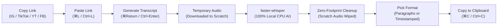

> [!TIP]
> ### 🌸 New here or want a simple 1-minute guide?
> **Check out the [Quick Start Guide for Friends & Creators (WELCOME_FRIEND.md)](WELCOME_FRIEND.md)** for a friendly, zero-jargon walkthrough on how to launch the app in 1 click, transcribe files, and download clips!

# 🦋 Faery Good Transcriber

> *"Small Batch, Whimsical Apothecary for the Tender Hearted — Whimsy is Power"*  
> Custom-crafted with love for **Ericka** & **[Faery Good](https://faerygood.com/)**

[](https://www.python.org/)
[](https://github.com/ApetriStefan/FaeryGood-Transcriber)
[](WELCOME_FRIEND.md)
[](https://github.com/SYSTRAN/faster-whisper)
[](https://faerygood.com/)

A delightful, 100% private, on-device desktop transcription studio and historical library. Built specifically for **Instagram Reels captions**, **TikTok subtitles**, and **timestamped transcripts**. Developed and tested on **Windows 10/11**, and engineered to run natively on **macOS** (Sonoma, Ventura, Monterey on Intel `x86_64` and Apple Silicon).

---

## ✨ Features at a Glance

* **🔒 100% On-Device & Private:** Powered by `faster-whisper` running locally on your computer's CPU (`int8` quantization with adaptive multi-core CPU worker threads, up to 8 threads) using English-optimized speech models (`small.en` and `base.en`). Your videos, voice memos, and transcripts **never** touch the cloud, require no third-party API keys, and incur zero recurring costs.
* **🎙️ Built-in Microphone Recording (`⌘D` / `Ctrl+D`):** Record voice notes and ideas directly inside the studio (`16kHz` mono PCM WAV via `sounddevice`) with a live `MM:SS` recording timer. Recordings are captured into a private scratch space, automatically transcribed on stop, and wiped cleanly afterward.
* **🌐 Paste Any Social Link (Instagram, TikTok, YouTube, Facebook):** Simply copy a link and click **`📋 Paste Link`** (`⌘L` / `Ctrl+L`). Audio is extracted into a temporary scratch space, resampled, transcribed, and **immediately destroyed**—leaving zero temporary media clutter on your hard drive.
* **📄 Smart Acoustic Formatting:**
  * **`📄 Clean Paragraphs`:** Automatically detects natural speech pauses ($\ge 1.0$s) to format speech into clean, readable paragraphs ready to paste into Instagram captions, newsletters, or blog posts.
  * **`⏱️ Timestamped`:** Automatically formats speech segments with `[MM:SS]` timestamps ideal for show notes, interview review, and video reference logs.
  * **`📝 Raw Text`:** Unformatted, continuous text stream ideal for note-taking apps or LLM prompts.
* **📜 Persistent History Library & Instant FTS5 Spoken-Word Search:**
  * View, search, rename, edit, copy, and delete past transcripts in the **`📜 History`** tab (`⌘2` / `Ctrl+2`).
  * **Crash-Safe Embedded SQLite Database:** All transcripts are persisted in `~/.faery_transcriber.db` with Write-Ahead Logging (`WAL` mode) for robust, atomic, corruption-proof operations.
  * **Instant SQLite FTS5 Full-Text Search:** Powered by an SQLite FTS5 virtual table with `unicode61` tokenization—enabling lightning-fast spoken word search not just by title or date, but **by any word or phrase spoken in the audio**!
  * **Speech Snippet Previews:** Search cards highlight the exact sentence from the transcript where the spoken words were detected (e.g. `💬 "...save for the muffled rhythm of rain..."`).
  * **Seamless Legacy Migration:** Automatically upgrades older JSON histories (`~/.faery_transcriptions_history.json`) into SQLite on startup, keeping a `.bak` copy for safety.
* **📻 Ambient Faery Radio (104.9 The Grift FM):** Toggle on the radio switch (`⌘R` / `Ctrl+R`) to summon a retro-modern ambient music player docked gracefully at the bottom of the screen. Features 9 original apothecary tracks, GTA-style DJ station bumpers, high-probability satirical legal disclaimers, embedded album artwork, click-to-seek timeline controls, and full keyboard media navigation. Completely disappears when toggled off to keep your workspace 100% clean.
* **🔐 Built-in "Social Login" Cookie Bridge:** Safely transcribe login-walled Instagram Reels or Facebook videos using your existing browser cookies (Safari, Chrome, Firefox, Edge, Brave) without ever sharing your password.
* **🔄 Automatic Weekly Background Updates:** When running from a git clone, the app automatically checks for and pulls updates from GitHub every 7 days upon launch, without ever interrupting your workflow.
* **🪄 Self-Calibrating Task ETA & Dynamic Estimate Display:** Upfront estimated time is displayed immediately when media is selected or recorded, accompanied by a whimsical `☕ (time for tea!)` indicator whenever jobs are estimated at 2 minutes or longer. Switching models dynamically recalculates the estimate. During transcription, a live blended estimator smoothly transitions from historical Real-Time Factor (RTF) to live measured throughput, continuously learning machine performance using an Exponential Moving Average (EMA) saved to settings.
* **🛡️ Silent Rotating Diagnostic & Crash Logger:** Built-in zero-noise telemetry running quietly in the background via rotating logs (`~/.faery_transcriber_crash.log`, 512KB cap), capturing standard library `faulthandler` thread dumps and uncaught background thread exceptions. If troubleshooting support is ever needed, a single click in **Help → 📋 Copy Diagnostic Log for Stef** copies complete system diagnostics and crash tracebacks directly to the clipboard without exposing private media or transcripts.
* **🌸 Bespoke Faery Good Aesthetics:** Custom-tailored to [FaeryGood.com](https://faerygood.com/) with watercolor fairy icons, whimsical butterfly accents, soft lavender backgrounds, and apothecary cream cards.

---

## 🚀 1-Click Launch (Zero-Jargon Quick Start)

Whether you are a creator, an artist, or a developer, launching the app takes less than a minute.

### 1. Clone or Download the Repository

```bash
git clone https://github.com/ApetriStefan/FaeryGood-Transcriber.git
cd FaeryGood-Transcriber
```

*(Non-technical friend? You can also click the green **Code → Download ZIP** button at the top of this GitHub page, then double-click the zip to unpack it!)*

---

### 2. Launch with One Click!

The repository includes intelligent **Self-Healing Launchers** that automatically detect Python, provision an isolated virtual environment (`.venv`), install required packages, and open the app:

* 🪟 **On Windows:** Double-click **`Run_Windows.bat`**
* 🍎 **On Mac:** Double-click **`Run_Mac.command`**

> [!NOTE]
> **First-Time Launch Note:** On the very first run, the launcher will take about 1–2 minutes to create the private environment and download the Whisper AI speech model. Subsequent launches open in seconds and run **100% offline** without needing an internet connection.
>
> If Python 3 is not installed, the launcher will pop up a friendly native dialog with a 1-click button to download Python from [python.org](https://www.python.org/downloads/).

#### 🛡️ macOS Security Tip (If Mac Asks on First Launch)
* If macOS displays *"Cannot be opened because it is from an unidentified developer"*:  
  Simply **Right-Click** (or `Control`-click) on `Run_Mac.command`, then choose **Open**. In the prompt that appears, click **Open**. macOS will remember your permission forever!
* If file permissions were stripped after unzipping:  
  Open Terminal, type `chmod +x `, drag `Run_Mac.command` into the Terminal window, and press `Enter`.

#### 🍎 Automatic macOS Applications Folder Integration
On its very first run, Faery Good Transcriber automatically creates and registers **`Faery Good Transcriber.app`** in your **`/Applications`** folder (falling back smoothly to `~/Applications` with zero administrative prompts if `/Applications` requires root permissions).

It automatically registers with macOS LaunchServices and clears quarantine attributes, allowing you to launch the app anytime from:
* 🔍 **Spotlight Search:** Press **`⌘+Space`**, type **`Faery`**, and press **`Enter`**.
* 🚀 **Launchpad:** Click the Faery Good butterfly icon directly from your app grid.
* 📁 **Dock / Finder:** Open it from your Applications folder or pin it to your Dock!

After the first double-click, you **never need to open the cloned project folder or Terminal again**.

---

## 🎬 Creator Workflows

### Workflow 1: Transcribe a Social Media Clip (Instagram, TikTok, YouTube, Facebook)



1. In your browser or mobile app, copy the link of any **Instagram Reel**, **YouTube video/Short**, **TikTok**, or **Facebook clip**.
2. In Faery Good Transcriber, click **`📋 Paste Link`** (or press `⌘L` on Mac / `Ctrl+L` on Windows).
3. *(Optional for Login-Walled Reels):* If the clip requires an account to view, choose your logged-in browser in the **`🔐 Social Login`** dropdown (`Auto / Public`, `Safari`, `Chrome`, `Firefox`, `Edge`, `Brave`).
4. Click **`✨ Generate Transcript`** (or press `⌘Return` / `Ctrl+Enter`).
   * The app extracts the audio stream into a private temporary scratch folder, converts it, streams the transcript live onto your screen, and **immediately deletes the audio download**.
   * When complete, a gentle apothecary chime plays!
5. Toggle between **`📄 Clean Paragraphs`** (for social captions/blogs) and **`⏱️ Timestamped`** (for `[MM:SS]` segment timestamps).
6. Click **`📋 Copy to Clipboard`** (`⌘C` / `Ctrl+C`) and paste it directly into your post!

---

## Workflow 2: Transcribe a Local Video, Podcast, or Voice Memo

1. Click **`📁 Select Video or Audio…`** (or press `⌘O` / `Ctrl+O`) to pick a file, or click **`🎙️ Record Mic`** (`⌘D` / `Ctrl+D`) to record a voice note directly from your microphone.
2. Select any media file on your computer (`.mp4`, `.mov`, `.m4a`, `.mp3`, `.wav`, `.mkv`, `.aac`, `.flac`).
3. Select your preferred **English Transcription Engine** (specifically tuned and optimized for English speech):
   * **`High Accuracy (small.en - Recommended)`:** Outstanding English punctuation, vocabulary, and grammar.
   * **`Standard (base.en - Fast)`:** 2x faster English transcription, perfect for short 30-second clips or quick drafts.
4. Click **`✨ Generate Transcript`** (`⌘Return` / `Ctrl+Enter`).
5. Output text files (`.txt`) and Markdown files (`.md`) are automatically saved to your output directory (`Documents/Transcriptions/` by default).

---

## Workflow 3: Explore & Search Your Library (History Tab)

1. Click the **`📜 History`** tab at the top (or press `⌘2` / `Ctrl+2`).
2. All your past transcripts appear in a clean, scrollable card list on the left.
3. **Smart Full-Text Search:**
   * Type in the search bar: you can search by **title**, **date**, **file name**, or **any word spoken in the audio**!
   * If a match is found in the spoken text, the card displays a live highlighted quote: `💬 "...muffled rhythm of rain lashing the floor..."`.
   * Press `Enter` to jump directly into the first match, or press `Escape` (or click `✕`) to clear the search.
4. **Instant In-App Actions:**
   * **Edit & Save:** Click into any transcript, make corrections, and click **`💾 Save Edits`** (`⌘S` / `Ctrl+S`).
   * **Rename:** Click **`✏️ Rename`** to rename the transcript and all corresponding disk files.
   * **Copy:** Click **`📋 Copy`** to grab the text instantly.
   * **Open Folder:** Click **`📂 Open Folder`** (`⇧⌘O` / `Ctrl+Shift+O`) to view the files in Finder or File Explorer.
   * **Delete:** Click **`🗑 Delete`** to safely remove old transcripts.

---

## 🔐 What is "Social Login" and What Is It For?

Under **Studio Preferences**, you will see a dropdown labeled **`Social Login`** with options like `Auto / Public (Recommended)`, `Safari (macOS)`, `Chrome`, `Firefox`, `Edge`, and `Brave`.

### Why is this needed?
Platforms like **Instagram** and **Facebook** often place Reels and videos behind a "Login Wall"—especially if a reel is from a private account, contains copyrighted background music, or if Instagram detects automated web traffic. When this happens, public downloads fail with an error like *"Login required"* or *"Sign in to confirm you're not a bot"*.

### How does Social Login solve this safely?
Unlike sketchy web downloaders that ask you to type your personal Instagram username and password (which is dangerous and compromises your account):
* **Faery Good Transcriber NEVER asks for or stores your password.**
* Instead, it uses `yt-dlp`'s secure cookie extraction to borrow the existing session cookies from the web browser you already use on your computer (`Safari` on Mac, `Chrome`, `Firefox`, etc.).
* Because you are already logged into Instagram in your web browser, the app can fetch the temporary audio stream seamlessly as if you were viewing it yourself!

### Which setting should you use?
* **`Auto / Public (Recommended)`:** Keep this selected by default! The app will always download public clips anonymously without touching any browser. If a clip is behind a login wall, the app displays a permission dialog asking if you want to allow browser cookie access before reading any cookies from Safari, Chrome, Edge, Brave, or Firefox.
* **`Safari (macOS)` / `Chrome` / `Firefox` / `Edge` / `Brave`:** If an Instagram Reel fails with a "Login required" message, you can also directly switch this dropdown to the browser where you are logged into Instagram, and click **Generate Transcript** again!

---

## 📻 Ambient Faery Radio (104.9 The Grift FM)

Need some inspiring background music while reviewing your work?

Toggle the **`📻 Radio`** switch in the top toolbar (or press `⌘R` / `Ctrl+R`) to tune into **104.9 The Grift FM**—a custom ambient lo-fi station complete with relaxing beats, embedded album art, and tongue-in-cheek radio bumpers.

* **9 Original Apothecary Tracks:** Stored in `assets/music/` and played locally with low CPU usage via `pygame.mixer`.
* **GTA-Style DJ Breaks & Bumpers:** Plays station IDs, anti-repeat bumper rotations, and hilarious satirical legal disclaimers between tracks.
* **Zero-Workspace Clutter:** When toggled off, the player vanishes completely from the UI, keeping 100% of the screen dedicated to your transcripts.
* **Click-to-Seek Timeline & Volume:** Jump anywhere in a song with a single mouse click or use full keyboard media controls.

---

## ⌨️ Keyboard Shortcuts Reference

| Action | macOS Shortcut | Windows Shortcut | Context |
| :--- | :--- | :--- | :--- |
| **Select Media File** | `⌘O` | `Ctrl+O` | Anywhere |
| **Record from Microphone** | `⌘D` | `Ctrl+D` | Anywhere |
| **Paste Social Link (IG/YT/TikTok/FB)** | `⌘L` | `Ctrl+L` | Anywhere |
| **Open Output Folder in Finder / Explorer** | `⇧⌘O` | `Ctrl+Shift+O` | Anywhere |
| **Generate Transcript** | `⌘Return` | `Ctrl+Enter` | Studio Tab |
| **Quick Save (.txt or History edits)** | `⌘S` | `Ctrl+S` | Active Editor |
| **Select All Text** | `⌘A` | `Ctrl+A` | Active Editor |
| **Copy Active Transcript** | `⌘C` | `Ctrl+C` | Active Editor |
| **Switch to Transcribe Studio Tab** | `⌘1` | `Ctrl+1` | Global |
| **Switch to History Library Tab** | `⌘2` | `Ctrl+2` | Global |
| **Toggle Ambient Faery Radio** | `⌘R` | `Ctrl+R` | Global |
| **Play / Pause Radio Playback** | `Space` | `Space` | Radio Active (outside text fields) |
| **Next Radio Track** | `⌘→` / `Media Next` | `Ctrl+→` / `Media Next` | Global |
| **Previous Radio Track** | `⌘←` / `Media Prev` | `Ctrl+←` / `Media Prev` | Global |
| **Volume Up / Down** | `⌘↑` / `⌘↓` | `Ctrl+↑` / `Ctrl+↓` | Global |
| **Mute / Unmute Radio** | `⌘M` | `Ctrl+M` | Global |
| **Clear History Search** | `Escape` | `Escape` | History Search Bar |
| **Quit Application** | `⌘Q` | `Alt+F4` | Global |

---

## 🌸 Faery Good Brand Art Direction

Every screen and control is designed to reflect Ericka's whimsical aesthetic:
* **Faery Royal Purple (`#7A2DB4`):** Primary typography, interactive pill buttons, and accent borders.
* **Soft Lavender Mist (`#EDE6FF`):** Signature dreamy background (paired with Enchanted Plum `#191024` in Dark Mode).
* **Warm Apothecary Cream (`#FCF4ED`):** Botanical card surfaces and input areas.
* **Petal Rose Mist (`#FCECF5`):** Highlighted transcript selection cards.
* **Herbal Sage Green (`#7EA156`):** Gentle visual confirmation pills (`✓ Copied!`, `✓ Saved!`).
* **Official Artwork (`assets/`):** Custom 1024×1024 macOS squircle app icon (`faery_icon.icns`), Windows multi-resolution icon (`faery_icon.ico`), cursive wordmarks, watercolor fairy mascot, and apothecary botanical icons (butterfly, mortar & pestle, herbal sprig).

---

## 🧠 Architecture & Under the Hood

Faery Good Transcriber is engineered to be self-contained, robust, and completely private:

1. **Audio Extraction, Resampling & Native WAV Fast-Path (Static FFmpeg):**  
   Whether you select a 4K `.mov` video, an `.mp4` reel, or paste a web link, bundled static FFmpeg binaries extract the audio and resample it into a clean **16,000Hz mono 16-bit PCM WAV stream**. Standard `.wav` files use a zero-subprocess native Python `wave` header fast-path for instant metadata inspection, and pre-normalized 16kHz mono PCM recordings (such as built-in microphone voice notes) bypass FFmpeg conversion entirely.
2. **On-Device AI Speech Recognition (`faster-whisper`):**  
   Runs OpenAI's Whisper model locally on your computer's CPU (`int8` quantization with adaptive multi-core CPU worker threads, up to 8 threads) with lazy model loading for instant app launch and 60ms coalesced real-time text streaming. No audio is transmitted over the internet, and inference runs at $\approx 3\times$ to $8\times$ real-time speed on modern processors.
3. **Smart Pause & Acoustic Pacing Formatter:**  
   Analyzes silence intervals between words in real time. Silences $\ge 1.0$ second automatically trigger clean paragraph breaks, matching your natural speaking cadence.
4. **Guaranteed Scratch Hygiene (`ScratchLifecycleManager`):**  
   All temporary audio processing, microphone voice recordings (`faery_mic_*`), and online downloads (`faery_transcribe_*`) occur inside isolated scratch directories. The lifecycle manager binds to application exit, cancellation handlers, and POSIX/Windows signals (`SIGTERM`, `SIGINT`) to guarantee that temporary audio files are purged immediately under all circumstances.
5. **Resilient Social Extraction & Background Self-Updating (`OnlineMediaFetcher` & `AutoUpdater`):**  
   Online extraction uses `yt-dlp[default]`, `yt-dlp-ejs`, and the bundled `deno` runtime to solve YouTube's JavaScript challenges out of the box without system-level setup. When executed from a git clone, `AutoUpdater` checks if 7 days have elapsed since the last check and automatically keeps `yt-dlp[default]`, `yt-dlp-ejs`, and `deno` updated alongside git commits in a non-blocking daemon thread. Standalone frozen builds safely bypass git checks.
6. **Modular Package Architecture (`faery_app/`):**  
   The application is organized into a clean, modular Python package (`faery_app/`) with cleanly decoupled subsystems (`config`, `lifecycle`, `models`, `media`, `transcription`, `radio`, `history`, `utils`, `ui`), fronted by `app.py` as a lightweight backwards-compatible facade and entry point.
7. **Embedded SQLite Database & Instant FTS5 Search:**  
   Past transcript sessions are stored in an embedded SQLite database (`~/.faery_transcriber.db`) operating under Write-Ahead Logging (`WAL` mode) with `PRAGMA synchronous=NORMAL` and busy timeout handling for crash safety. Spoken transcripts are indexed in an SQLite FTS5 virtual table with `unicode61` tokenization, enabling sub-millisecond full-text queries, BM25-based relevance ranking, and contextual snippet highlighting. Legacy JSON libraries (`~/.faery_transcriptions_history.json`) are seamlessly auto-migrated on startup with automatic `.bak` backup creation.
8. **Self-Calibrating Task ETA & Blended Estimator (`TranscriptionEngine` & `ConfigManager`):**  
   Before processing begins, the engine evaluates duration against persisted historical Real-Time Factor (`model_rtf`). As transcription progresses, a live blended estimator smoothly transitions from historical performance to real-time throughput over the first 25% of audio duration. Upon task completion, an Exponential Moving Average ($\text{new\_rtf} = \text{round}(0.7 \times \text{current} + 0.3 \times \text{observed}, 3)$) updates persisted calibration, adapting to machine performance and thermal state over time.
9. **Silent Rotating Diagnostic & Crash Logger (`crash_logger.py`):**  
   Telemetry runs silently without polluting the user interface. Employs a 512KB rotating log handler (`~/.faery_transcriber_crash.log`), links into `sys.excepthook` and `threading.excepthook`, and activates Python's C-level `faulthandler` with `all_threads=True` to catch fatal interpreter terminations. The Help menu's "Copy Diagnostic Log" action extracts this data (or synthesizes a clean hardware and platform summary) to the system clipboard for effortless, zero-leak troubleshooting.

For comprehensive developer documentation and architectural specifications, explore the repository's **Core-Knowledge** base:
* 🧭 **[Core-Knowledge Index](knowledge/core_knowledge/index.md)** — Architectural routing table and folder contracts.
* 🏗️ **[System Architecture](knowledge/core_knowledge/architecture.md)** — Deep-dive on modular package structure, threading model, audio pipeline, and scratch lifecycle.
* 🧩 **[Architectural Components](knowledge/core_knowledge/components/_about.md)** — Subsystem contracts across `faery_app/` and facade mappings.
* 🛠️ **[Infrastructure & Packaging](knowledge/core_knowledge/infrastructure/_about.md)** — Self-healing launchers, PyInstaller specs, and DMG creation.
* 📋 **[Processes & Quality Verification](knowledge/core_knowledge/processes/_about.md)** — Test verification routines and friend delivery SOPs.

---

## 🧪 Testing & Packaging

### Running the Test Suite
The repository includes an extensive automated test suite covering all critical subsystems (scratch cleanup, formatters, audio duration calculations, UI state transitions):

```bash
# Activate your virtual environment, then run:
python test_app.py
```
*(All 59 automated unit and integration tests execute in under 6 seconds).*

### Building Standalone macOS App & DMG
If you want to create a native macOS drag-and-drop installer:
1. Double-click **`Build_Mac_App.command`** to build `FaeryTranscriber.app`.
2. Double-click **`Create_Mac_DMG.command`** to compile the DMG installer:
   ```text
   FaeryTranscriber-Intel-Mac.dmg
   ```
3. Drag the app into your `/Applications` folder!

---

## ❓ Frequently Asked Questions (FAQ)

#### Q: Where are my transcript files stored?
> By default, all transcripts are saved in your **`Documents/Transcriptions`** folder. You can open it anytime by pressing `⇧⌘O` / `Ctrl+Shift+O` or clicking **`📂 Open Folder`** in the Transcribe Studio tab.

#### Q: Does this app upload my voice or videos to the internet?
> **No, never.** All audio extraction and transcription run 100% locally on your computer's CPU. No audio, video, or text is ever sent to any third-party server or cloud AI provider.

#### Q: How does the social link feature work?
> The app uses `yt-dlp` and FFmpeg to extract only the audio stream directly into a private temporary folder (`tempfile.TemporaryDirectory`). Once the speech engine finishes transcribing, the temporary audio is deleted immediately. Zero video or audio clutter remains on your hard drive.

#### Q: An Instagram or Facebook reel says "Login required". How do I transcribe it?
> In the **`🔐 Social Login`** dropdown under preferences, select the browser where you are logged into your account (e.g. `Safari (macOS)`, `Chrome`, `Edge`, etc.), then click **`Generate Transcript`** again. The app will securely use your browser's existing session cookies without needing you to enter your password.

#### Q: How do automatic updates work?
> **Only when you launch the app**, it checks if 7 days have passed since the previous check. If your computer is connected to the internet, it runs a background check to pull any new updates from GitHub (`origin main`). It will never interrupt you with constant checks while you are using the app. You can also manually check anytime via **Help → Check for Updates from GitHub...**.

---

## 📦 Project File Map

```text
TranscriptionEngine/
├── WELCOME_FRIEND.md           # 🌸 Friendly 1-minute visual guide for friends & creators
├── README.md                   # 📖 Complete user documentation, architecture & guides
├── app.py                      # 💻 Backwards-compatible public facade & application entry point
├── faery_app/                  # 🏰 Modular application package
│   ├── __init__.py             # 📦 Root package initializer & public exports
│   ├── __main__.py             # 🚀 Module entry point (python -m faery_app)
│   ├── constants.py            # 🎨 Visual themes, colors, audio playlists & defaults
│   ├── config/                 # ⚙️ Persistent configuration manager (config.json)
│   ├── lifecycle/              # 🧹 ScratchLifecycleManager (sandbox hygiene) & AutoUpdater
│   ├── models/                 # 📄 Domain models (Metadata, Segments) & TranscriptFormatter
│   ├── media/                  # 🎬 MediaProcessor (FFmpeg 16kHz WAV), OnlineMediaFetcher (yt-dlp/deno) & recorder.py (MicrophoneRecorder)
│   ├── transcription/          # 🧠 TranscriptionEngine (faster-whisper local CPU inference)
│   ├── radio/                  # 📻 RadioStationController (104.9 Grift FM) & album art
│   ├── history/                # 📜 HistoryManager (SQLite & FTS5 full-text search)
│   ├── utils/                  # 🛠️ System utilities & zero-sudo macOS application installer
│   └── ui/                     # 🌸 CustomTkinter presentation layer (views, dialogs, menus, dock)
├── requirements.txt            # 📦 Production Python dependencies
├── test_app.py                 # 🧪 Automated unit & integration test suite (41 tests)
├── Run_Windows.bat             # 🪟 1-Click self-healing Windows launcher
├── Run_Mac.command             # 🍎 1-Click self-healing macOS launcher & auto-installer to Applications
├── Build_Mac_App.command       # 🍏 1-Click standalone .app bundle builder
├── Create_Mac_DMG.command      # 💿 1-Click drag-and-drop .dmg installer creator
├── FaeryTranscriber.spec       # ⚙️ PyInstaller standalone packaging specification
├── assets/                     # 🎨 Official Faery Good icons, artwork & audio
│   ├── music/                  # 🎵 Original ambient tracks (9 songs)
│   ├── announcer/              # 🎙️ GTA-style DJ station clips, disclaimers & bumpers
│   ├── faery_icon.icns         # 🍎 macOS native application & DMG icon
│   ├── faery_icon.ico          # 🪟 Windows native multi-size application icon
│   ├── faery_icon.png          # 🖼️ High-res 1024x1024 squircle app icon
│   ├── faery_mascot.png        # 🧚 Watercolor fairy mascot illustration
│   ├── faery_logo_light.png    # ✒️ Cursive "Faery Good" wordmark (Light mode)
│   ├── faery_logo_dark.png     # ✒️ Cursive "Faery Good" wordmark (Dark mode)
│   ├── faery_butterfly_*.png   # 🦋 Whimsical butterfly section icon
│   ├── faery_mortar_*.png      # 🌿 Apothecary mortar & pestle section icon
│   ├── faery_sprig_*.png       # 🌱 Botanical herbal sprig section icon
│   └── faery_good_theme.json   # 🎨 CustomTkinter theme matching FaeryGood.com
└── knowledge/                  # 🧭 Authoritative Core-Knowledge Repository
    └── core_knowledge/         # 🏛️ Architecture, components, infrastructure & processes
        ├── architecture.md     # 🏗️ System overview, modular architecture & scratch lifecycle
        ├── index.md            # 🗺️ Routing table & documentation contracts
        ├── components/         # 🧩 Architectural subsystem contracts
        ├── infrastructure/     # 🛠️ Launchers, packaging & test infrastructure
        ├── processes/          # 📋 QA procedures & friend delivery steps
        └── team_and_stakeholders/ # 👥 Team registry, contacts & ownership map
```

---

*Crafted with care and whimsy for Ericka & Faery Good.*  
*Visit the apothecary at **[FaeryGood.com](https://faerygood.com/)**.*
