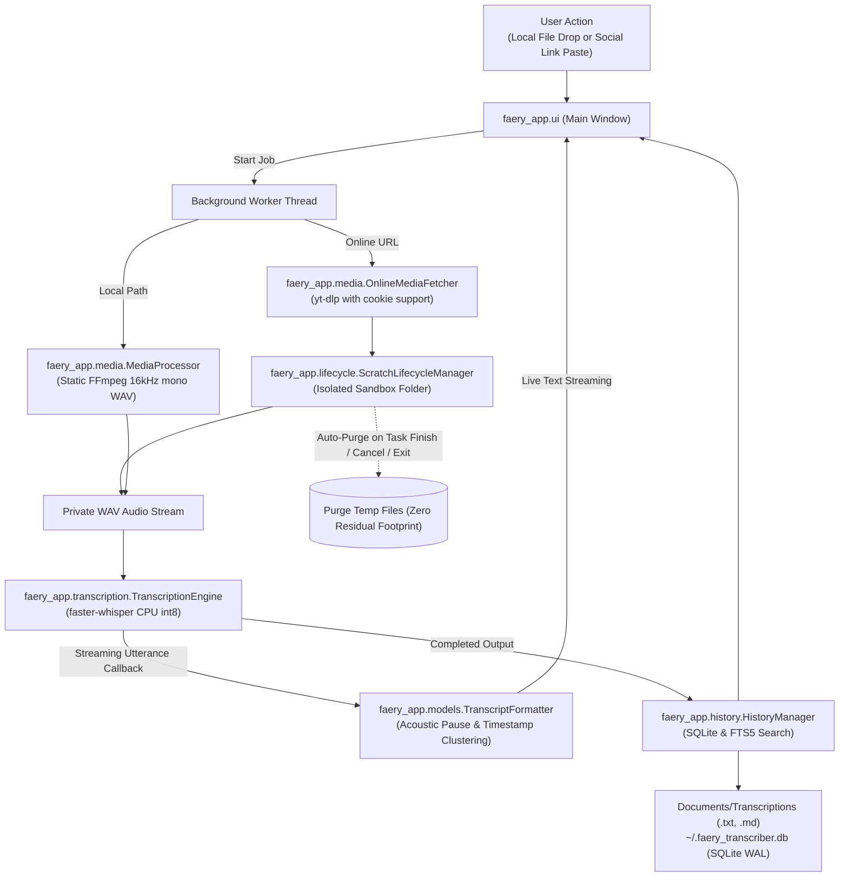

# System Architecture — Faery Good Transcriber

## 1. High-Level Architecture Overview

Faery Good Transcriber is designed as a modular, privacy-first, self-contained desktop application. Originally constructed as a monolithic script, the codebase has been decomposed into a clean, decoupled Python package (`faery_app/`) while retaining a lightweight, backwards-compatible public facade (`app.py`).

The architecture guarantees:
1. **100% On-Device Execution:** All speech recognition and audio processing run strictly on the local CPU without external network API calls or cloud dependencies.
2. **Responsive Multithreaded UI:** The CustomTkinter graphical interface operates exclusively on the main thread, delegating CPU-intensive inference, network downloads, and audio decoding to background worker threads.
3. **Guaranteed Scratch Hygiene:** Ephemeral files and working media exist solely within isolated, auto-purging sandboxes managed by `ScratchLifecycleManager`.
4. **Backwards Compatibility:** Legacy scripts, unit test runners (`test_app.py`), and standalone PyInstaller packaging (`FaeryTranscriber.spec`) continue targeting `app.py` without disruption.

### 1.1 Modular Subsystem Architecture

```mermaid
flowchart TD
    subgraph Facade ["Entry Point & Public Facade"]
        AppPy["app.py / faery_app.__main__"]
    end

    subgraph Presentation ["faery_app.ui (Presentation Layer)"]
        MainWindow["FaeryTranscriberApp\n(Window Orchestrator)"]
        StudioView["TranscribeStudioView\n(Studio Tab)"]
        HistoryView["HistoryLibraryView\n(History Tab)"]
        RadioDock["RadioPlayerDock\n(104.9 Grift FM Dock)"]
        Dialogs["Modal Dialogs\n(About, Quick Guide, Overwrite, CookiePermission)"]
        Menus["MenuBuilder\n(Shortcuts & Menus)"]
        Assets["BrandAssets & FaerySegmentedButton"]

        MainWindow --> StudioView
        MainWindow --> HistoryView
        MainWindow --> RadioDock
        MainWindow --> Dialogs
        MainWindow --> Menus
        MainWindow --> Assets
    end

    subgraph CoreServices ["faery_app Core Subsystems"]
        Config["faery_app.config\n(Thread-Safe ConfigManager & RTF Calibration)"]
        Lifecycle["faery_app.lifecycle\n(ScratchLifecycleManager, AutoUpdater & CrashLogger)"]
        Media["faery_app.media\n(MediaProcessor, OnlineMediaFetcher, MicrophoneRecorder)"]
        Transcription["faery_app.transcription\n(TranscriptionEngine & Task ETA)"]
        Models["faery_app.models\n(Metadata, TranscriptFormatter & format_eta)"]
        Radio["faery_app.radio\n(RadioStationController & Art Extractor)"]
        History["faery_app.history\n(HistoryManager & HistoryRecord)"]
        Utils["faery_app.utils\n(System, macOS Mach-O Bundle & TCC Helpers)"]
    end

    AppPy --> MainWindow
    MainWindow --> Config
    MainWindow --> Lifecycle
    MainWindow --> Media
    MainWindow --> Transcription
    MainWindow --> Models
    MainWindow --> Radio
    MainWindow --> History
    MainWindow --> Utils
```



### 1.2 Data Flow & Transcription Pipeline



---

## 2. Modular Package Structure & Component Breakdown

The codebase is organized into domain-specific packages under `faery_app/`:

```text
faery_app/
├── __init__.py                 # Package root & public exports
├── __main__.py                 # Standalone execution entry (python -m faery_app)
├── constants.py                # Global constants, color themes, fonts, playlists, paths
├── config/                     # Configuration persistence & calibration
│   ├── __init__.py
│   └── config_manager.py       # ConfigManager (config.json & model_rtf EMA)
├── lifecycle/                  # Process & storage hygiene, crash telemetry
│   ├── __init__.py
│   ├── scratch.py              # ScratchLifecycleManager
│   ├── updater.py              # AutoUpdater (7-day git sync)
│   └── crash_logger.py         # Silent rotating diagnostic & crash logger
├── models/                     # Domain dataclasses & text formatters
│   ├── __init__.py
│   ├── metadata.py             # MediaMetadata, TranscriptSegment, OnlineClipInfo
│   └── formatter.py            # TranscriptFormatter & format_eta countdowns
├── media/                      # Audio extraction, microphone recording & network fetching
│   ├── __init__.py
│   ├── processor.py            # MediaProcessor (FFmpeg 16kHz mono conversion)
│   ├── online_fetcher.py       # OnlineMediaFetcher (yt-dlp[default], yt-dlp-ejs, deno & cookies)
│   └── recorder.py             # MicrophoneRecorder (sounddevice 16kHz mono WAV capture)
├── transcription/              # Local speech inference engine
│   ├── __init__.py
│   └── engine.py               # TranscriptionEngine (faster-whisper English-optimized wrapper)
├── radio/                      # Ambient music & satirical bumpers
│   ├── __init__.py
│   ├── types.py                # RadioTrackType enum
│   ├── art.py                  # extract_embedded_art (ID3 / mutagen / PIL)
│   └── controller.py           # RadioStationController (pygame.mixer)
├── history/                    # Historical transcript repository (SQLite & FTS5)
│   ├── __init__.py
│   └── history_manager.py      # HistoryRecord, SearchResult & HistoryManager (SQLite/FTS5)
├── utils/                      # OS & platform helpers
│   ├── __init__.py
│   ├── system.py               # System utilities (FFmpeg finder, disk space, open folder)
│   └── macos.py                # Mach-O .app builder, TCC mic permission helpers & App Nap guard
└── ui/                         # CustomTkinter graphical presentation layer
    ├── __init__.py
    ├── assets.py               # BrandAssets (colors, icons, fonts)
    ├── menus.py                # MenuBuilder & keyboard shortcuts
    ├── main_window.py          # FaeryTranscriberApp (controller window)
    ├── components/
    │   ├── __init__.py
    │   └── segmented_button.py # FaerySegmentedButton
    ├── dialogs/
    │   ├── __init__.py
    │   ├── about.py            # AboutDialog
    │   ├── quick_guide.py      # QuickGuideDialog
    │   ├── overwrite_prompt.py # OverwritePromptDialog
    │   └── cookie_permission.py # CookiePermissionDialog
    └── views/
        ├── __init__.py
        ├── transcribe_view.py  # TranscribeStudioView
        ├── history_view.py     # HistoryLibraryView
        └── radio_dock.py       # RadioPlayerDock
```

### 2.1 Public Facade (`app.py`)
- **Role:** Backwards-compatible public facade module.
- **Implementation:** Re-exports all public classes, enums, dataclasses, functions, and configuration constants from `faery_app`.
- **Startup Sequence:** Executes High-DPI awareness setup on Windows, invokes `ensure_macos_app_installed()` on macOS, and starts the `FaeryTranscriberApp` main loop.
- **Compatibility:** Guarantees zero breakage for PyInstaller bundling scripts (`FaeryTranscriber.spec`), existing test harnesses (`test_app.py`), and platform batch/shell scripts (`Run_Windows.bat`, `Run_Mac.command`).

### 2.2 Configuration Management (`faery_app.config`)
- **Primary Symbol:** `ConfigManager` in `faery_app/config/config_manager.py`.
- **Responsibilities:**
  - Thread-safe (`threading.RLock()`) loading and atomic persistence (`save()` writes via `tempfile.NamedTemporaryFile` + `os.fsync()` + `os.replace()`) of user preferences in `~/.faery_transcriber_config.json` (window size, output format, selected speech model, pause threshold, social login browser, timestamp of the last update check, ambient radio settings, and `model_rtf` mapping).
  - **Hardware RTF Calibration Persistence (`model_rtf`):** Persists historical Real-Time Factor (RTF) benchmarks for each transcription model (`large-v3-turbo`: baseline default 0.48, `small.en`: default 0.35, `base.en`: default 0.15), clamped within the safety interval $[0.05, 3.0]$.
  - **Exponential Moving Average Calibration (`update_model_rtf`):** Dynamically updates persisted model RTFs upon completion of non-empty audio transcriptions ($\ge 10.0\text{s}$) using the formula:
    $$\text{new\_rtf} = \text{round}(0.7 \times \text{current\_rtf} + 0.3 \times \text{observed\_rtf}, 3)$$
    ensuring duration estimates continuously adapt to the specific machine's thermal and CPU processing capabilities without abrupt volatility.
  - Handles missing, whitespace-only (`output_directory` fallback to `DEFAULT_OUTPUT_DIR`), or corrupted configuration files safely by automatically falling back to sensible defaults.

### 2.3 Lifecycle Management & Sandbox Hygiene (`faery_app.lifecycle`)
- **Primary Symbols:**
  - `ScratchLifecycleManager` in `faery_app/lifecycle/scratch.py`
  - `AutoUpdater` in `faery_app/lifecycle/updater.py`
  - Crash logger utilities (`init_crash_logging`, `log_exception`, `get_diagnostic_log_content`) in `faery_app/lifecycle/crash_logger.py`
- **Responsibilities:**
  - **Scratch Directory Sandbox & PID Lockfiles:** Provides `safe_scratch_directory()` context manager and `create_persistent_scratch_dir()` ensuring temporary files and microphone captures are quarantined in isolated folders (`faery_transcribe_*`, `faery_mic_*`). `register_dir()` writes a `.faery.pid` marker inside each scratch folder, and `register_cleanup_callback()` allows active stream/handle owners to close resources right before `cleanup_all_active()` deletes directories.
  - **Failsafe Purge Hooks:** Registers handlers across `atexit`, `signal.SIGINT`, `signal.SIGTERM`, and GUI close events to eradicate active scratch data before process termination.
  - **Windows Anti-Lock Retry:** Implements exponential backoff when deleting directories on Windows to overcome temporary file locks held by antivirus scanners or system indexers.
  - **Startup Orphan Sweeper:** On application launch, silently purges abandoned `faery_transcribe_*`, `faery_scratch_*`, and `faery_mic_*` folders (checking `.faery.pid` via `_is_pid_running()` across POSIX `os.kill(pid, 0)` and Windows `OpenProcess`/`GetExitCodeProcess` so live sibling instances are never wiped) alongside partial Hugging Face `*.incomplete` cache files left by previous system crashes or forced restarts.
  - **Automated Repository & Extractor Updates:** Non-blocking 7-day interval check for repository updates via git, followed by background upgrades of `yt-dlp[default]`, `yt-dlp-ejs`, and `deno` (plus automatic `pip install -r requirements.txt -q` sync whenever pulled commits modify `requirements.txt`). Features standalone bundle immunity (`sys.frozen` check — remaining `False` even when launched from the compiled Mach-O `.app` source bundle), multi-endpoint DNS+HTTPS connectivity fallback (`1.1.1.1:53`, `8.8.8.8:53`, `github.com:443`), and safe stash-pop conflict rollback (`git stash push` + `git checkout -- .` if `git stash pop` fails).
  - **Silent Rotating Diagnostic & Crash Logger (`crash_logger.py`):**
    - **Zero-Noise Initialization (`init_crash_logging`):** Idempotent bootstrap configuring a dedicated `RotatingFileHandler` writing to `~/.faery_transcriber_crash.log` capped at 512 KB with 1 historical backup.
    - **Isolated Native Thread Dump Interception (`faulthandler`):** Arms Python standard library `faulthandler` pointing at a separate dedicated file descriptor (`~/.faery_transcriber_faulthandler.log`) with `all_threads=True` so `RotatingFileHandler` log rollover on Windows never collides with `faulthandler`, while still capturing hard C-level interpreter crashes, segmentation faults, and fatal abort signals.
    - **Unhandled Exception Interception:** Hooks into `sys.excepthook` for uncaught main thread exceptions and `threading.excepthook` for background worker crashes, formatting full tracebacks and flushing handlers synchronously to disk.
    - **Diagnostic Log Extraction (`get_diagnostic_log_content`):** Extracts the tail (up to 100 lines) of `~/.faery_transcriber_crash.log` with local user home path redaction (`str(Path.home())` replaced by `~`) for clipboard export. If the log is clean or absent, dynamically synthesizes a home-path-redacted system diagnostic summary including OS release/version, CPU architecture, Python runtime path/version, and available system RAM via `psutil`.
    - **Contextual Exception Logging (`log_exception`):** Formats and synchronously flushes structured error records with optional context tags.

### 2.4 Domain Models & Formatting (`faery_app.models`)
- **Primary Symbols:**
  - `MediaMetadata`, `TranscriptSegment`, `OnlineClipInfo`, `format_seconds_mm_ss` in `faery_app/models/metadata.py`
  - `TranscriptFormatter`, `format_eta` in `faery_app/models/formatter.py`
- **Responsibilities:**
  - Strongly typed data structures representing media properties and transcription utterances.
  - **Task ETA Formatter (`format_eta`):** Translates remaining duration seconds into intuitive human-friendly intervals: `< 15s` as `"a few seconds"`, `< 60s` as `"{s}s"`, `< 3600s` as `"{m} min"` or `"{m}m {s}s"`, and $\ge 3600\text{s}$ as `"{h}h {m}m"`.
  - **Acoustic Pause Detection:** Clusters continuous speech segments into clean, readable paragraphs when inter-word pauses exceed the configured threshold ($\ge 1.0\text{s} - 1.2\text{s}$).
  - **Paragraph Boundary Healing (`_heal_paragraph`):** Automatically normalizes punctuation and capitalization at paragraph boundaries:
    - Capitalizes the opening character of a paragraph if lowercase.
    - Strips leading and trailing extraneous whitespace.
    - Converts dangling non-terminal punctuation (commas `,`, colons `:`, semicolons `;`) at paragraph boundaries into terminal periods (`.`).
    - Appends a terminal period (`.`) to unpunctuated alphanumeric boundaries.
    - Preserves all legitimate terminal punctuation (`.`, `!`, `?`, `."`, `!"`, `?"`, `”`, `…`).
  - **Timestamped Transcripts (`[MM:SS]`):** Generates structured segment timestamps formatted as `[MM:SS]` for show notes, interview review, and video reference logs.
  - **Markdown Generation:** Formats complete transcripts with metadata headers and timestamps for documentation export.

### 2.5 Media Processing, Microphone Recording & Social Extraction (`faery_app.media`)
- **Primary Symbols:**
  - `MediaProcessor` in `faery_app/media/processor.py`
  - `OnlineMediaFetcher` in `faery_app/media/online_fetcher.py`
  - `MicrophoneRecorder` in `faery_app/media/recorder.py`
- **Responsibilities:**
  - **Acoustic Normalization & Native WAV Fast-Path:** Converts arbitrary audio/video formats into 16,000Hz mono 16-bit PCM WAV using statically bundled FFmpeg binaries (`imageio_ffmpeg`). Includes a zero-subprocess native Python `wave` header fast-path (`MediaProcessor._probe_wav_fast`) for instant metadata probing on `.wav` files, and an extraction bypass (`MediaProcessor.is_16k_mono_pcm_wav`) that skips FFmpeg conversion entirely when a source file (such as a 16kHz built-in microphone recording) is already 16,000Hz mono 16-bit PCM WAV.
  - **Microphone Voice Recording (`MicrophoneRecorder`):** Captures 16-bit mono PCM WAV audio directly from the system's default input device via `sounddevice.InputStream` into a `faery_mic_*` scratch folder managed by `ScratchLifecycleManager`.
    - **Lock-Free Audio Pipeline:** PortAudio's real-time `_audio_callback` pushes PCM buffers into a lock-free `queue.SimpleQueue` drained by a dedicated `FaeryMicWriter` daemon thread (`_writer_loop`), ensuring disk I/O never blocks hardware audio callbacks.
    - **Sample-Rate Negotiation:** `_probe_input_device()` queries the default input device name and native sample rate (`detected_sr`); `start_recording()` tries `16000` Hz first (for zero-copy Whisper bypass) and automatically falls back to `detected_sr` if the hardware/driver rejects 16kHz.
    - **Real-Time RMS/Peak & All-Zero Rejection:** Computes normalized RMS (`current_level` in `[0.0, 1.0]`), `peak_sample`, `is_all_silent()`, and `get_silence_duration_seconds()` via `numpy`. On `stop_recording()`, rejects all-zero captures (`peak_sample == 0`)—raising `PermissionError` on macOS (signaling TCC-blocked audio) or `ValueError` elsewhere—and immediately purges the scratch folder.
  - **Social Media Ingestion:** Uses `yt-dlp[default]`, `yt-dlp-ejs`, and a bundled `deno` runtime (`_get_deno_executable()`, guarded by a thread-safe `threading.Lock()` `_deno_lock` with module-level path caching to avoid repeated disk lookups) to solve YouTube JavaScript challenges and extract audio streams from Instagram Reels, TikTok videos, YouTube videos/Shorts, and Facebook clips. Retains the most informative/authentication error across retries.
  - **Consent-Gated Browser Cookie Bridge:** Reads session cookies (`cookies_from_browser`) from Safari, Chrome, Firefox, Edge, or Brave (`LOGIN_BROWSER_MAP`) to unlock login-walled media without collecting or storing user credentials. In `Auto / Public` mode, browser cookie access is gated behind an explicit user consent prompt (`CookiePermissionDialog`); when the user explicitly selects a browser, fallback prompts are skipped.

### 2.6 Local Speech Recognition Engine (`faery_app.transcription`)
- **Primary Symbol:** `TranscriptionEngine` in `faery_app/transcription/engine.py`.
- **Responsibilities:**
  - Wraps `faster_whisper.WhisperModel` running entirely on CPU using `int8` quantization for optimal memory usage and inference speed, using lazy module importing inside `load_model()` for instant GUI cold-start.
  - **Pure-Silence Rejection (`_validate_non_silent_audio`):** Before invoking `whisper_model.transcribe()`, checks decoded NumPy waveforms and raises `ValueError` if the array is empty or contains only digital zeros (`max(|audio|) == 0.0`).
  - **Hardware & Thermal-Aware CPU Scaling:** Configured with physical-core thread detection via `TranscriptionEngine.get_optimal_cpu_threads()` (querying `sysctl -n hw.physicalcpu` on macOS, `psutil.cpu_count(logical=False)` if available, and heuristics capped at `min(8, max(2, physical_cores))`). Caps thread allocation strictly to physical cores rather than virtual hyperthreads, preventing cache thrashing and thermal throttling on thin-and-light laptops.
  - **Intel OpenMP Zero Spin-Wait:** Sets `KMP_BLOCKTIME=0` and `OMP_WAIT_POLICY=PASSIVE` at the module entry level before `ctranslate2` initializes, ensuring OpenMP worker threads yield immediately rather than busy-spinning at 100% CPU between audio chunks.
  - **macOS Sonoma App Nap & Sleep Immunity:** Inference execution loops (`run_transcription` and `run_online_transcription`) are wrapped with the `prevent_app_nap()` context manager, spawning a background `caffeinate -i -w <pid>` process to prevent macOS Sonoma power management from throttling background transcription when the application window is occluded or minimized.
  - Supports English-optimized model selection:
    - `large-v3-turbo` (default, maximum accuracy, 809M parameters, 4-layer fast decoder, ~809 MB INT8, baseline RTF 0.48).
    - `small.en` (high accuracy, 244M parameters, ~244 MB INT8, baseline RTF 0.35).
    - `base.en` (standard draft, 74M parameters, ~74 MB INT8, baseline RTF 0.15).
  - **Punctuation Priming & Conditioning:** Supplies `initial_prompt=DEFAULT_PUNCTUATION_PROMPT` (`"Hello! Welcome to this recording. We ensure clean, natural punctuation, proper capitalization, and complete sentences."`) and enables `condition_on_previous_text=True` to enforce consistent question mark detection, capitalization, and book-quality punctuation cadence across transcription segments.
  - **Self-Calibrating Task ETA & Countdown Telemetry:**
    - **Initial ETA Calculation:** Before starting audio inference, queries historical model RTF (`ConfigManager.get_model_rtf(model_name)`) to establish an initial job estimate: $\text{initial\_eta} = \max(1, \text{round}(\text{total\_duration} \times \text{hist\_rtf}))$.
    - **Blended Live Countdown:** During token generation, calculates instantaneous progress from segment timestamps ($\text{progress} = \min(0.99, \max(0.01, \text{segment.end} / \text{total\_duration}))$) and live observed RTF ($\text{rtf\_live} = \text{elapsed} / \max(0.1, \text{segment.end})$). Smoothly blends historical and live rates over the first 25% of audio playback ($\text{weight} = \min(1.0, \text{progress} / 0.25)$, $\text{rtf\_eff} = (1.0 - \text{weight}) \times \text{hist\_rtf} + \text{weight} \times \text{rtf\_live}$), predicting remaining seconds $\text{eta\_sec} = \max(1, \text{round}((\text{total\_duration} - \text{segment.end}) \times \text{rtf\_eff}))$.
    - **Automatic Post-Inference Calibration:** For jobs where audio duration $\ge 10.0\text{s}$ **and** `segments_collected` is non-empty (skipping calibration on 0-segment/silent runs), computes overall observed RTF ($\text{elapsed} / \text{total\_duration}$) and updates persisted model calibration in `ConfigManager` via Exponential Moving Average (EMA).
  - Emits real-time progress callbacks for responsive UI streaming.

### 2.7 Ambient Radio Subsystem (`faery_app.radio`)
- **Primary Symbols:**
  - `RadioStationController` in `faery_app/radio/controller.py`
  - `RadioTrackType` in `faery_app/radio/types.py`
  - `extract_embedded_art` in `faery_app/radio/art.py`
- **Responsibilities:**
  - Lo-fi ambient audio player (104.9 The Grift FM) executing on a dedicated background audio channel via `pygame.mixer`, rotating 17 original ambient compositions (`assets/music/`) interspersed with GTA-style satirical DJ bumpers (`assets/announcer/`).
  - Filters assets strictly to SDL_mixer-reliable formats (`.mp3`, `.wav`, `.ogg`).
  - Tracks `_consecutive_failures` to guard against infinite failure loops (calling `stop()` after `max(1, min(len(self.music_files) or 1, 3))` consecutive playback errors), and calls `pygame.mixer.music.unload()` in `stop()` to release open file handles.
  - Extracts embedded ID3 APIC album artwork via `mutagen` or `rfind(b"\xff\xd9", jpg_idx)` JPEG trailer scanning in `art.py`, with procedural PIL image fallbacks.
  - Interactive playback controls: play/pause, track skipping, seekable timeline scrubbing, and volume adjustment with mute memory.

### 2.8 History Library & Search Engine (`faery_app.history`)
- **Primary Symbols:**
  - `HistoryRecord`, `SearchResult`, `HistoryManager` in `faery_app/history/history_manager.py`
  - **Embedded SQLite Storage Architecture:**
  - **Database Location:** Backed by an embedded SQLite database persisted at `~/.faery_transcriber.db` (resolved via `constants.DB_PATH`), ensuring crash-safe ACID transactions with a `@contextmanager` connection lifecycle that deterministically closes `sqlite3.Connection` handles.
  - **High-Concurrency WAL Mode:** Initialized with `PRAGMA journal_mode=WAL;` (Write-Ahead Logging), allowing concurrent reader connections without blocking active write operations. Configured with `PRAGMA synchronous=NORMAL;`, `PRAGMA busy_timeout=10000;`, and `PRAGMA foreign_keys=ON;` for data safety and lock resilience.
  - **Relational Schema (`transcriptions` table):**
    ```sql
    CREATE TABLE IF NOT EXISTS transcriptions (
        id TEXT PRIMARY KEY,
        title TEXT NOT NULL,
        source_filename TEXT DEFAULT '',
        duration_str TEXT DEFAULT '--:--',
        created_at TEXT DEFAULT '',
        model TEXT DEFAULT '',
        paragraphs_file TEXT DEFAULT '',
        timecoded_file TEXT DEFAULT '',
        markdown_file TEXT DEFAULT '',
        word_count INTEGER DEFAULT 0,
        is_favorite INTEGER DEFAULT 0,
        tags TEXT DEFAULT '',
        updated_at TEXT DEFAULT ''
    );
    ```
  - **Full-Text Search Engine (`transcriptions_fts` virtual table):**
    - Built using SQLite's FTS5 virtual table extension with the `unicode61` tokenizer for international character, diacritic, and case-insensitive normalization:
      ```sql
      CREATE VIRTUAL TABLE IF NOT EXISTS transcriptions_fts USING fts5(
          id UNINDEXED,
          title,
          content,
          tokenize = 'unicode61'
      );
      ```
    - **Automated Lifecycle Triggers:**
      - `trg_transcriptions_delete`: Automatically purges index rows from `transcriptions_fts` upon deletion of corresponding records in `transcriptions`.
      - `trg_transcriptions_update_title`: Propagates title modifications to the virtual search index.
    - **Full-Text Content Indexing:** Spoken text content is read directly from disk files (`paragraphs_file` or `markdown_file`) upon insertion or update and indexed into `transcriptions_fts`.
  - **Query Processing & Contextual Snippets:**
    - `search_with_snippets(query)` utilizes FTS5 prefix token matching (`"term"*`), BM25-based relevance ranking, and the SQLite `snippet(transcriptions_fts, 2, '', '', '...', 15)` function to return contextual speech quotes (e.g., `💬 "...muffled rhythm of rain..."`).
    - Multi-tiered fallback evaluates FTS5 matches alongside multi-token SQL `LIKE` metadata matching (`AND`-joined across all query tokens) across titles, filenames, models, dates, and tags.
    - Returns `SearchResult` objects that inherit from `HistoryRecord` while supporting 2-tuple unpacking (`record, snippet = result`) for complete backwards compatibility.
  - **Seamless Legacy JSON Migration, Rollback-Safe Renames & Non-Destructive Sync:**
    - On initialization (`_migrate_legacy_json`), detects legacy JSON history at `~/.faery_transcriptions_history.json`, deserializes all records, executes a single batched SQLite transaction for insertions and FTS5 indexing, and renames the legacy file to `~/.faery_transcriptions_history.json.bak`.
    - `sync_with_directory(output_dir)` discovers external or untracked transcripts in `Documents/Transcriptions` using collision-safe millisecond+UUID IDs (`{stem}_{ms}_{uuid6}`), batches all insertions and stale-record cleanups into a single atomic SQLite transaction, and returns `List[HistoryRecord]`. If `output_dir.iterdir()` raises `OSError` or a record's parent directory is unreadable/unmounted (`os.access(fp.parent, os.R_OK)`), sync returns non-destructively without wiping database records.
    - `rename_record()` validates destination filename conflicts upfront and rolls back already-moved files if a later rename or SQLite update fails.
    - `update_record_content(record_id, new_text)` performs an $O(1)$ targeted update of `word_count`, `updated_at`, and the single record's `transcriptions_fts` entry without re-scanning the output directory.

### 2.9 Platform & System Utilities (`faery_app.utils`)
- **Primary Symbols:**
  - System utilities in `faery_app/utils/system.py` (`get_verified_ffmpeg_exe`, `check_free_disk_space`, `open_system_folder`, `open_system_file`, `play_completion_sound`, `is_directory_writable`)
  - macOS integrations in `faery_app/utils/macos.py` (`ensure_macos_app_installed`, `_compile_macos_macho_launcher`, `_is_bundle_current`, `_create_macos_app_bundle`, `_register_macos_app_bundle`, `get_macos_microphone_auth_status`, `request_macos_microphone_access`, `ensure_macos_mic_permission`, `open_macos_mic_privacy_settings`, `prevent_app_nap`)
- **Responsibilities:**
  - Resolves static FFmpeg binaries (with in-memory path and `os.path.exists` caching to eliminate redundant filesystem probes) and verifies free disk space before transcription tasks.
  - Native file manager integration (`explorer.exe` on Windows, `open` on macOS).
  - **macOS App Nap Prevention:** Provides the `prevent_app_nap()` context manager managing the `caffeinate -i -w <pid>` execution lifecycle during heavy background inference tasks.
  - **Zero-Sudo macOS Application Installer & Mach-O TCC Host:**
    - `ensure_macos_app_installed()` installs `Faery Good Transcriber.app` into `/Applications` (or `~/Applications` fallback without admin prompts).
    - **In-Process Mach-O Launcher (`_compile_macos_macho_launcher`):** When Xcode Command Line Tools `clang` is present (`_can_compile_macos_launcher()`), compiles a lightweight Mach-O binary launcher inside `Contents/MacOS/Faery Good Transcriber` that hosts the repository's `.venv` Python interpreter in-process via `dlopen(libpython)` + `Py_BytesMain` (falling back to `execv` if needed). Keeping execution inside the `.app` bundle's Mach-O process preserves macOS TCC attribution (`kTCCServiceMicrophone` / `NSMicrophoneUsageDescription`) for Spotlight and `/Applications` launches while keeping `sys.frozen=False` so `AutoUpdater` continues to work.
    - **Bundle Currency Sentinel & Codesigning:** Writes `Contents/.faery_bundle_meta.json` and checks `_is_bundle_current()` so subsequent launches skip rebuilding an already-current bundle (upgrading legacy bash-script bundles once to Mach-O when CLT is installed), preserving macOS TCC grants and signatures. Strips quarantine flags (`xattr -cr`), ad-hoc signs via `codesign --force --deep --sign -` with `macos_entitlements.plist` (`com.apple.security.device.audio-input`, `com.apple.security.device.microphone`, `allow-jit`, `allow-unsigned-executable-memory`, `disable-library-validation`), preserves framework symlinks (`shutil.copytree(..., symlinks=True)`) in frozen-bundle replication, and registers with LaunchServices (`lsregister -f`) for Spotlight discovery (`⌘+Space`).
  - **Zero-Dependency ObjC/AVFoundation TCC Helpers:** Uses `ctypes` bindings to `libobjc` and `AVFoundation.framework` (`AVCaptureDevice`) to query microphone status (`get_macos_microphone_auth_status()`), trigger the native macOS permission dialog (`request_macos_microphone_access()`), preflight access before starting capture (`ensure_macos_mic_permission()`), and deep-link directly to **System Settings → Privacy & Security → Microphone** (`open_macos_mic_privacy_settings()`).

### 2.10 Graphical User Interface Layer (`faery_app.ui`)
- **Primary Symbols:**
  - `FaeryTranscriberApp` in `faery_app/ui/main_window.py`
  - Views: `TranscribeStudioView`, `HistoryLibraryView`, `RadioPlayerDock` in `faery_app/ui/views/`
  - Dialogs: `AboutDialog`, `QuickGuideDialog`, `OverwritePromptDialog`, `CookiePermissionDialog` in `faery_app/ui/dialogs/`
  - Components: `FaerySegmentedButton` in `faery_app/ui/components/`
  - Assets: `BrandAssets` in `faery_app/ui/assets.py`
  - Menus: `MenuBuilder` in `faery_app/ui/menus.py`
- **Responsibilities:**
  - CustomTkinter window management with warm palette styling ("Faery Good" aesthetic), native `.AppleSystemUIFont` typography on macOS (`Segoe UI` on Windows) configured in `main_window.py` and `assets/faery_good_theme.json`, and WCAG AA contrast tokens (`FAERY_SAGE_GREEN` `#466E36`, `FAERY_SNIPPET_TEXT`).
  - View orchestration: Dual-tab interface switching between Transcribe Studio and History Library, with non-blocking startup (`after(250, ...)` background directory sync) and macOS `::tk::mac::Quit` binding.
  - **High-Throughput UI Rendering & Event Handling:**
    - **60ms Coalesced Live Segment Streaming:** Buffers incoming `TranscriptSegment` callbacks and flushes incremental updates to the studio textbox at most once every 60ms (`_flush_stream_render`), keeping the studio textbox read-only during active inference and disabling copy/export buttons (`copy_btn`, `save_txt_btn`, `save_md_btn`) until transcript text exists.
    - **Empty / 0-Segment Outcome Guard:** When a transcription finishes with `word_count == 0` or no `current_segments`, skips false-success status and history saving, resetting progress to `0.0` and guiding the user (or prompting to open macOS Microphone Settings after a silent mic capture).
    - **Live Microphone Meter & Silence Alerts:** `TranscribeStudioView` provides `mic_level_row` (`mic_level_bar`, `mic_signal_label`), polled at 100ms by `_recording_tick()` to show active speech vs. `>= 2.0s` silence warnings; starting a recording auto-pauses Faery Radio and suppresses the `Space` radio shortcut until recording stops.
    - **$O(1)$ In-Place History Card Highlighting, 80ms Debounced Search & Dirty-Edit Guard:** Selecting a History card updates only the previous and newly selected card widgets in place without destroying or recreating the scrollable widget tree; keystroke search queries are debounced by 80ms (`_on_history_search_changed`). `HistoryLibraryView` tracks edits via `<KeyRelease>` (`_history_dirty`), prompting `_confirm_discard_history_edits()` before switching records, changing preview format, or closing the window, displays a two-row responsive CRUD toolbar, and surfaces an inline note when a requested `.txt`/`.md` format falls back to Clean Paragraphs.
    - **Thread-Safe Dialog & Lifecycle Guards:** All worker `after()` callbacks check `winfo_exists()`, and `_threadsafe_prompt_overwrite` / `_threadsafe_prompt_cookie_permission` bound `threading.Event.wait(timeout=300.0)`.
    - **Upfront Task ETA & Tea Break Indicator:** On media selection or microphone capture, `TranscribeStudioView._update_file_metadata_display` computes estimated task duration using the active model's calibrated RTF. If estimated time $\ge 120\text{s}$ (2 minutes), appends a whimsical `☕ (time for tea!)` hint to the metadata display (`🪄 Est. time: ~{format_eta(est_sec)}{tea_hint}`).
    - **Dynamic Model-Switching Recalculation:** When switching models via the dropdown, `_on_model_changed` triggers immediate recalculation of the selected media's estimate using the newly selected model's RTF.
    - **Diagnostic Log Clipboard Action:** Provides a Help menu option to copy diagnostic system information and crash logs (`get_diagnostic_log_content`, with home paths redacted) to the system clipboard, allowing the end user to easily share diagnostic telemetry with the lead developer when requesting technical support.
  - Bottom-docked collapsible ambient radio player.
  - Keyboard shortcut dispatcher (`⌘Return`/`Ctrl+Enter`, `⌘L`/`Ctrl+L`, `⌘O`/`Ctrl+O`, `⌘D`/`Ctrl+D`, `⇧⌘C`/`Ctrl+Shift+C` for active transcript copy while keeping native `⌘C`/`Ctrl+C` for text selections, `⌘R`/`Ctrl+R`).

---

## 3. Platform Distribution & Self-Healing Launchers

| Platform | Launcher Script | Self-Healing & Fallback Behavior |
|---|---|---|
| **Windows 10/11** | `Run_Windows.bat` | • Strictly enforces Python >= 3.10 across `PATH`, `py -3`, `%LOCALAPPDATA%\Programs\Python` (Python 3.10–3.13), and `%ProgramFiles%\Python` (Python 3.10–3.13; legacy 3.8/3.9 pruned).<br>• Detects and automatically purges stale or incompatible `.venv` directories.<br>• If Python 3.10+ is missing, triggers a native PowerShell WinForms GUI alert with a 1-click button opening python.org.<br>• Automatically provisions `.venv`, silently installs dependencies (`requirements.txt`, including `numpy>=1.24.0`), and launches `app.py`. |
| **macOS** | `Run_Mac.command` | • Detects Python 3.10–3.13 across official framework paths, Intel/Apple Silicon Homebrew, user shims, and PATH using `is_valid_python()`, rejecting legacy/stub versions (e.g., macOS built-in Python 3.9 stub).<br>• Detects and purges stale `.venv` directories created with Python < 3.10.<br>• If missing, presents a native AppleScript alert with a 1-click **Install Python** action that downloads and opens the official Python 3.12 installer package (`python-3.12.10-macos11.pkg`).<br>• Provisions `.venv`, validates required packages, and launches `app.py` (which handles single-source `.app` bundle installation, Mach-O TCC launcher compilation, and LaunchServices registration via `ensure_macos_app_installed()`). |
| **Packaged Binary** | `FaeryTranscriber.spec` | • PyInstaller 6.x build configuration (`target_arch=None`, UPX disabled on macOS) for windowed execution (`console=False`).<br>• Bundles `faery_app.lifecycle.crash_logger` and runtime assets (17 radio MP3s, station bumpers, brand icons, warm theme JSON, static FFmpeg).<br>• Applies ad-hoc `codesign` with `macos_entitlements.plist` on macOS (also reinforced by `Build_Mac_App.command`). Targets `app.py` as entry point for seamless packaging. |

---

## 4. Architectural Invariants & Concurrency Rules

1. **Non-Blocking UI Thread:** Heavy operations (audio download, FFmpeg resampling, Whisper inference) MUST execute on background worker threads. The UI main loop communicates strictly via thread-safe callbacks or queued state updates.
2. **Scratch Isolation:** No audio extraction routine may write directly to persistent storage. All intermediate media MUST be created inside a `safe_scratch_directory()` context.
3. **Graceful Standalone Immunity:** Network or development tools (e.g., `git`) MUST query `AutoUpdater.is_standalone_bundle()` and skip execution silently when running under a frozen PyInstaller binary (`sys.frozen`).
4. **Platform Safety:** Platform-specific modules (such as macOS application registration in `faery_app.utils.macos`) MUST verify the operating system (`sys.platform == 'darwin'`) before executing platform APIs, failing gracefully on unsupported operating systems.
5. **Database Concurrency & Integrity:** All persistent library access to `~/.faery_transcriber.db` executes under SQLite WAL journal mode with a 10-second busy timeout. Deletions and title updates are transactionally synced with the FTS5 virtual index, and schema migrations preserve user data with automatic `.bak` backups.
