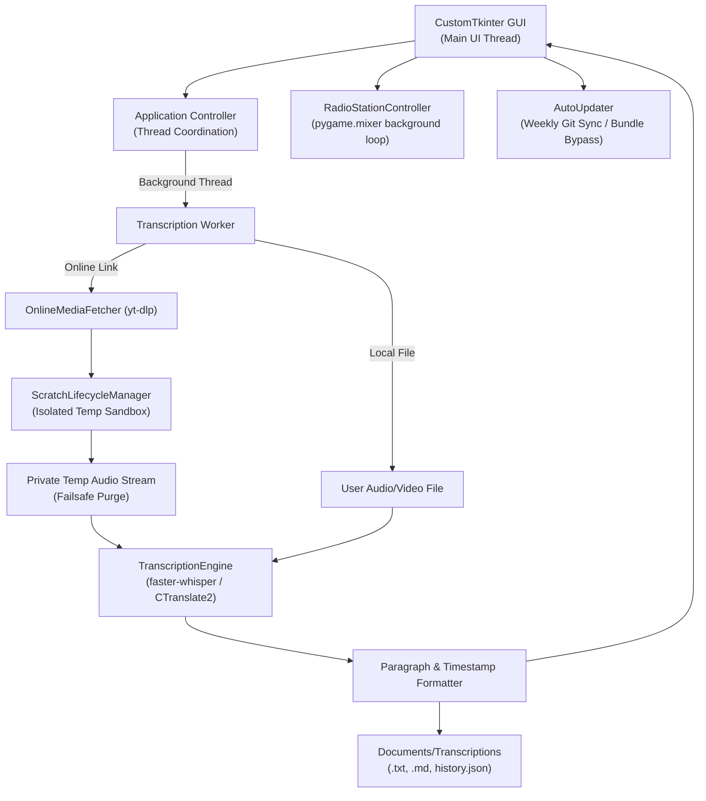

# System Architecture — Faery Good Transcriber

## 1. High-Level Architecture Overview

Faery Good Transcriber is designed as a self-contained, privacy-first desktop application with a non-blocking multithreaded architecture. The user interface remains 60fps responsive during heavy transcription workloads and background audio playback.

---

## 2. Core Modules & Subsystems

### 2.1 Desktop GUI (`FaeryTranscriberApp`)
- Built with `customtkinter` using the custom `"Faery Good"` warm palette theme.
- **Dual-Tab Workflow:**
  - **Transcribe Studio:** Bento card layout, real-time live transcript streaming, output mode switching (Clean Paragraphs, Timecoded, Raw Text).
  - **History Library:** Instant multi-field search, in-place transcript editing, 1-click clipboard export, and direct folder navigation.
- **System Integrations:** Menu bar shortcuts (`Ctrl+Enter` / `⌘Return`, `Ctrl+O` / `⌘O`, `Ctrl+R` / `⌘R`), drag-and-drop file support, and native window close handling.

### 2.2 Local Inference Engine (`TranscriptionEngine`)
- Implements `faster_whisper.WhisperModel` running 100% on CPU (`int8` quantization for optimal speed and memory efficiency).
- Multi-core thread tuning (`cpu_threads=4`, `num_workers=1`) ensuring zero UI freezing during inference.
- Multi-format output generation:
  - Natural paragraph clustering based on spoken pause thresholds (`pause_threshold=1.2s`).
  - Video chapter timecoding `[MM:SS]` formatted specifically for YouTube description markers.
  - Raw unsegmented text export.

### 2.3 Social Media Extraction (`OnlineMediaFetcher`)
- Powered by `yt_dlp.YoutubeDL` paired with static FFmpeg binaries (`imageio_ffmpeg`).
- Supports Instagram Reels, YouTube videos/Shorts, TikTok clips, and Facebook watch URLs.
- Cookie-based authentication support (`cookies_from_browser`) allowing access to age-gated or login-restricted media without credential storage.
- Operates entirely inside directories managed by `ScratchLifecycleManager`.

### 2.4 Scratch Storage Lifecycle & Hygiene (`ScratchLifecycleManager`)
- Provides failsafe, silent lifecycle hygiene for all temporary audio conversions, model download fragments, and working directories.
- **Lifecycle Guarantees:**
  1. *Normal Completion:* Automatically deletes working directories via the `safe_scratch_directory` context manager upon task finish.
  2. *User Cancellation:* Immediately purges active scratch directories when the user cancels an in-flight job.
  3. *Unexpected Termination:* Hooks into `atexit`, `signal.SIGINT`, `signal.SIGTERM`, and GUI `on_closing` events to wipe scratch data before process death.
  4. *Anti-Lock Resilience:* Retries directory removal using exponential backoff to handle transient Windows OS file locks (e.g., Windows Defender, Search Indexer, or delayed handle release).
  5. *Startup Orphan Sweeper:* On application startup, silently scans system temporary storage for any orphaned `faery_transcribe_*` or `faery_scratch_*` folders left by power outages or system crashes, alongside abandoned Hugging Face `*.incomplete` model cache fragments.

### 2.5 Ambient Radio Subsystem (`RadioStationController`)
- Powered by `pygame.mixer` on an isolated audio channel.
- Plays original ambient tracks and procedural GTA-style satirical radio bumpers (104.9 The Grift FM).
- Anti-repeat bumper selection, embedded ID3 album artwork extraction (`mutagen` / PIL), and click-to-seek progress timeline scrubbing.
- Keyboard playback controls (`Space` to play/pause, arrow keys for track skipping and volume adjustment).

### 2.6 Automatic Maintenance & Updating (`AutoUpdater`)
- Non-blocking 7-day interval check for repository updates:
  - *Standalone Bundle Immunity:* Automatically detects PyInstaller packaged environments (`sys.frozen`) and gracefully skips Git operations to prevent crashes.
  - *Git Environment Checks:* Verifies `git` binary availability in `PATH` and confirms the presence of a valid `.git` repository folder.
  - *Network Check:* Fast, non-blocking DNS ping (Cloudflare 1.1.1.1 / Google 8.8.8.8) to prevent timeouts when offline.
  - *Safe Pull Mechanism:* Fast-forward merge with automatic stash/pop protection for local user configuration files.

### 2.7 Automated macOS Application Registration Subsystem (`ensure_macos_app_installed` & `install_app_bundle`)
- Implemented in Python (`ensure_macos_app_installed`, `_create_macos_app_bundle`, `_register_macos_app_bundle` in `app.py`) and mirrored in shell (`install_app_bundle` in `Run_Mac.command`).
- **Bootstrap Execution:** Executes automatically during application startup (`main()`) before GUI initialization, guaranteeing immediate registration on first launch.
- **Execution Mode Handling:**
  - *Source-Run Mode (Git clone / unpacked folder):* Synthesizes a valid `Faery Good Transcriber.app` bundle on the fly. Generates `Contents/Info.plist` (metadata, bundle ID `com.faerygood.transcriber`, category `public.app-category.video`), an executable launcher wrapper (`Contents/MacOS/Faery Good Transcriber`) targeting `.venv/bin/python` / `Run_Mac.command`, and copies the native icon (`Contents/Resources/faery_icon.icns`).
  - *Frozen Bundle Mode (`sys.frozen`):* Detects standalone PyInstaller bundle root and synchronizes the active `.app` bundle into the target Applications directory (no-op if already executing from target).
- **Zero-Sudo Permission Fallback (`/Applications` -> `~/Applications`):**
  - Evaluates system directory writability via `is_directory_writable()`.
  - Target selection: installs to `/Applications` if writable; otherwise falls back gracefully to `~/Applications` (`$HOME/Applications`).
  - Eliminates administrative privilege escalation requirements (`sudo`) or write-failure crashes on restricted accounts.
- **LaunchServices Registration & Spotlight Discovery:**
  - *Gatekeeper Clearance:* Strips quarantine flags using `xattr -cr`.
  - *LaunchServices Registration:* Forcefully registers the bundle using `lsregister -f` (`/System/Library/Frameworks/CoreServices.framework/Frameworks/LaunchServices.framework/Support/lsregister`).
  - *Spotlight Invalidation:* Touches bundle directory mtime (`os.utime` / `touch`), prompting instant Spotlight indexing (`⌘+Space`) and Launchpad cataloging without requiring a system restart.

---

## 3. Platform Distribution & Self-Healing Launchers

| Platform | Launcher Script | Self-Healing & Fallback Behavior |
|---|---|---|
| **Windows 10/11** | `Run_Windows.bat` | • Searches `PATH`, `py -3`, `%LOCALAPPDATA%\Programs\Python`, and `%ProgramFiles%\Python` across Python 3.8–3.13. • If Python is missing, triggers a native PowerShell GUI dialog with a 1-click button opening python.org. • Automatically provisions and verifies `.venv`, installs/updates missing dependencies silently, and launches `app.py`. |
| **macOS** | `Run_Mac.command` | • Detects Homebrew (`/opt/homebrew`, `/usr/local`), system, and PATH Python 3 binaries. • If missing, invokes native AppleScript dialogs offering 1-click download navigation. • Provisions `.venv`, validates required packages, and launches windowed application. • Executes `install_app_bundle` to register `Faery Good Transcriber.app` into `/Applications` (or `~/Applications` fallback), strips quarantine flags (`xattr -cr`), and registers with LaunchServices (`lsregister -f`) for instant Spotlight discovery (`⌘+Space`). |
| **Packaged Binary** | `FaeryTranscriber.spec` | • PyInstaller 6.x build configuration for windowed execution (`console=False`). • Bundles runtime assets (radio MP3s, station bumpers, brand icons, warm theme JSON, static FFmpeg). |
