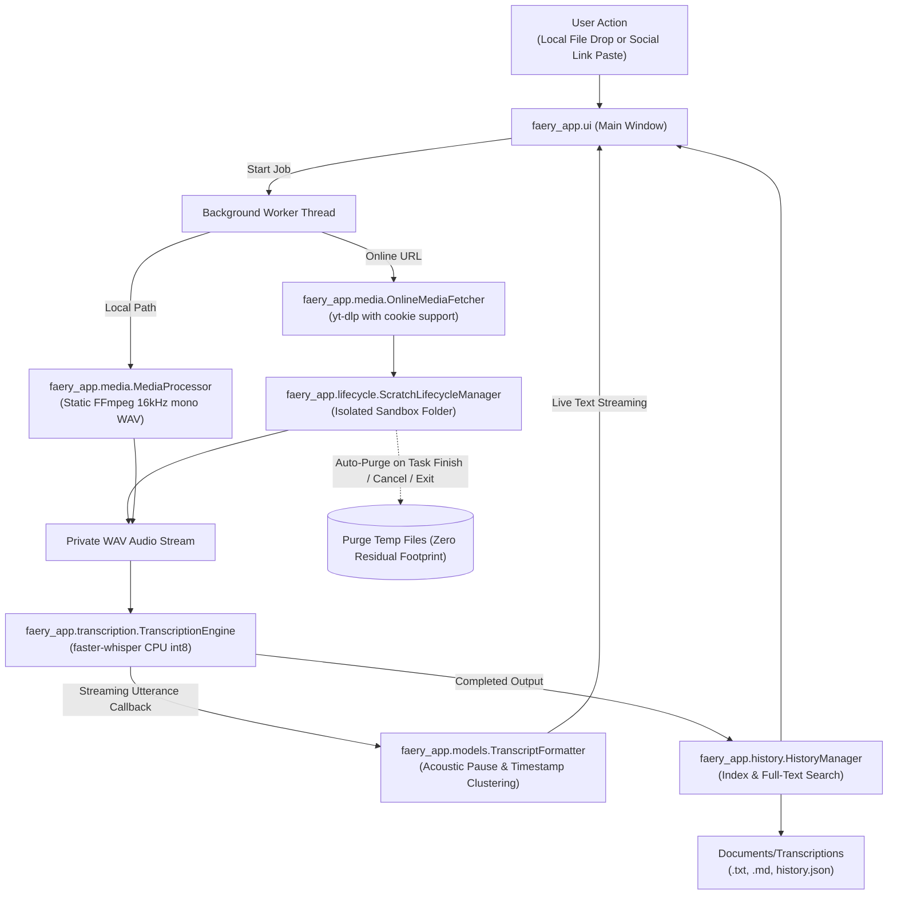

# System Architecture — Faery Good Transcriber

## 1. High-Level Architecture Overview

Faery Good Transcriber is designed as a modular, privacy-first, self-contained desktop application. Originally constructed as a monolithic script, the codebase has been decomposed into a clean, decoupled Python package (`faery_app/`) while retaining a lightweight, backwards-compatible public facade (`app.py`).

The architecture guarantees:
1. **100% On-Device Execution:** All speech recognition and audio processing run strictly on the local CPU without external network API calls or cloud dependencies.
2. **Responsive Multithreaded UI:** The CustomTkinter graphical interface operates exclusively on the main thread, delegating CPU-intensive inference, network downloads, and audio decoding to background worker threads.
3. **Guaranteed Scratch Hygiene:** Ephemeral files and working media exist solely within isolated, auto-purging sandboxes managed by `ScratchLifecycleManager`.
4. **Backwards Compatibility:** Legacy scripts, unit test runners (`test_app.py`), and standalone PyInstaller packaging (`FaeryTranscriber.spec`) continue targeting `app.py` without disruption.

### 1.1 Modular Subsystem Architecture

```mermaid
flowchart TD
    subgraph Facade ["Entry Point & Public Facade"]
        AppPy["app.py / faery_app.__main__"]
    end

    subgraph Presentation ["faery_app.ui (Presentation Layer)"]
        MainWindow["FaeryTranscriberApp\n(Window Orchestrator)"]
        StudioView["TranscribeStudioView\n(Studio Tab)"]
        HistoryView["HistoryLibraryView\n(History Tab)"]
        RadioDock["RadioPlayerDock\n(104.9 Grift FM Dock)"]
        Dialogs["Modal Dialogs\n(About, Quick Guide, Overwrite)"]
        Menus["MenuBuilder\n(Shortcuts & Menus)"]
        Assets["BrandAssets & FaerySegmentedButton"]

        MainWindow --> StudioView
        MainWindow --> HistoryView
        MainWindow --> RadioDock
        MainWindow --> Dialogs
        MainWindow --> Menus
        MainWindow --> Assets
    end

    subgraph CoreServices ["faery_app Core Subsystems"]
        Config["faery_app.config\n(ConfigManager)"]
        Lifecycle["faery_app.lifecycle\n(ScratchLifecycleManager & AutoUpdater)"]
        Media["faery_app.media\n(MediaProcessor & OnlineMediaFetcher)"]
        Transcription["faery_app.transcription\n(TranscriptionEngine)"]
        Models["faery_app.models\n(Metadata & TranscriptFormatter)"]
        Radio["faery_app.radio\n(RadioStationController & Art Extractor)"]
        History["faery_app.history\n(HistoryManager & HistoryRecord)"]
        Utils["faery_app.utils\n(System & macOS Integrations)"]
    end

    AppPy --> MainWindow
    MainWindow --> Config
    MainWindow --> Lifecycle
    MainWindow --> Media
    MainWindow --> Transcription
    MainWindow --> Models
    MainWindow --> Radio
    MainWindow --> History
    MainWindow --> Utils
```



### 1.2 Data Flow & Transcription Pipeline



---

## 2. Modular Package Structure & Component Breakdown

The codebase is organized into domain-specific packages under `faery_app/`:

```text
faery_app/
├── __init__.py                 # Package root & public exports
├── __main__.py                 # Standalone execution entry (python -m faery_app)
├── constants.py                # Global constants, color themes, fonts, playlists
├── config/                     # Configuration persistence
│   ├── __init__.py
│   └── config_manager.py       # ConfigManager (config.json)
├── lifecycle/                  # Process & storage hygiene
│   ├── __init__.py
│   ├── scratch.py              # ScratchLifecycleManager
│   └── updater.py              # AutoUpdater (7-day git sync)
├── models/                     # Domain dataclasses & text formatters
│   ├── __init__.py
│   ├── metadata.py             # MediaMetadata, TranscriptSegment, OnlineClipInfo
│   └── formatter.py            # TranscriptFormatter (paragraphs, timecodes, markdown)
├── media/                      # Audio extraction & network fetching
│   ├── __init__.py
│   ├── processor.py            # MediaProcessor (FFmpeg 16kHz mono conversion)
│   └── online_fetcher.py       # OnlineMediaFetcher (yt-dlp download & cookies)
├── transcription/              # Local speech inference engine
│   ├── __init__.py
│   └── engine.py               # TranscriptionEngine (faster-whisper wrapper)
├── radio/                      # Ambient music & satirical bumpers
│   ├── __init__.py
│   ├── types.py                # RadioTrackType enum
│   ├── art.py                  # extract_embedded_art (ID3 / mutagen / PIL)
│   └── controller.py           # RadioStationController (pygame.mixer)
├── history/                    # Historical transcript repository
│   ├── __init__.py
│   └── history_manager.py      # HistoryRecord & HistoryManager (spoken search)
├── utils/                      # OS & platform helpers
│   ├── __init__.py
│   ├── system.py               # System utilities (FFmpeg finder, disk space, open folder)
│   └── macos.py                # macOS bundle installer & LaunchServices registrar
└── ui/                         # CustomTkinter graphical presentation layer
    ├── __init__.py
    ├── assets.py               # BrandAssets (colors, icons, fonts)
    ├── menus.py                # MenuBuilder & keyboard shortcuts
    ├── main_window.py          # FaeryTranscriberApp (controller window)
    ├── components/
    │   ├── __init__.py
    │   └── segmented_button.py # FaerySegmentedButton
    ├── dialogs/
    │   ├── __init__.py
    │   ├── about.py            # AboutDialog
    │   ├── quick_guide.py      # QuickGuideDialog
    │   └── overwrite_prompt.py # OverwritePromptDialog
    └── views/
        ├── __init__.py
        ├── transcribe_view.py  # TranscribeStudioView
        ├── history_view.py     # HistoryLibraryView
        └── radio_dock.py       # RadioPlayerDock
```

### 2.1 Public Facade (`app.py`)
- **Role:** Backwards-compatible public facade module.
- **Implementation:** Re-exports all public classes, enums, dataclasses, functions, and configuration constants from `faery_app`.
- **Startup Sequence:** Executes High-DPI awareness setup on Windows, invokes `ensure_macos_app_installed()` on macOS, and starts the `FaeryTranscriberApp` main loop.
- **Compatibility:** Guarantees zero breakage for PyInstaller bundling scripts (`FaeryTranscriber.spec`), existing test harnesses (`test_app.py`), and platform batch/shell scripts (`Run_Windows.bat`, `Run_Mac.command`).

### 2.2 Configuration Management (`faery_app.config`)
- **Primary Symbol:** `ConfigManager` in `faery_app/config/config_manager.py`.
- **Responsibilities:**
  - Loads and persists user preferences in `config.json` (window size, output format, selected speech model, pause threshold, social login browser, and timestamp of the last update check).
  - Handles missing or corrupted configuration files safely by automatically falling back to sensible defaults.

### 2.3 Lifecycle Management & Sandbox Hygiene (`faery_app.lifecycle`)
- **Primary Symbols:**
  - `ScratchLifecycleManager` in `faery_app/lifecycle/scratch.py`
  - `AutoUpdater` in `faery_app/lifecycle/updater.py`
- **Responsibilities:**
  - **Scratch Directory Sandbox:** Provides `safe_scratch_directory()` context manager ensuring temporary files are quarantined in isolated folders (`faery_transcribe_*`).
  - **Failsafe Purge Hooks:** Registers handlers across `atexit`, `signal.SIGINT`, `signal.SIGTERM`, and GUI close events to eradicate active scratch data before process termination.
  - **Windows Anti-Lock Retry:** Implements exponential backoff when deleting directories on Windows to overcome temporary file locks held by antivirus scanners or system indexers.
  - **Startup Orphan Sweeper:** On application launch, silently purges abandoned `faery_transcribe_*` folders and partial Hugging Face `*.incomplete` cache files left by previous system crashes or forced restarts.
  - **Automated Repository Updates:** Non-blocking 7-day interval check for repository updates via git. Features standalone bundle immunity (`sys.frozen` check) to skip Git operations in packaged binaries, DNS reachability tests, and git stash/pull safety.

### 2.4 Domain Models & Formatting (`faery_app.models`)
- **Primary Symbols:**
  - `MediaMetadata`, `TranscriptSegment`, `OnlineClipInfo`, `format_seconds_mm_ss` in `faery_app/models/metadata.py`
  - `TranscriptFormatter` in `faery_app/models/formatter.py`
- **Responsibilities:**
  - Strongly typed data structures representing media properties and transcription utterances.
  - **Acoustic Pause Detection:** Clusters continuous speech segments into clean, readable paragraphs when inter-word pauses exceed the configured threshold ($\ge 1.0\text{s} - 1.2\text{s}$).
  - **YouTube Chapter Timecoding:** Generates structured timestamps formatted as `[MM:SS]` compatible with YouTube description chapter markers.
  - **Markdown Generation:** Formats complete transcripts with metadata headers and timestamps for documentation export.

### 2.5 Media Processing & Social Extraction (`faery_app.media`)
- **Primary Symbols:**
  - `MediaProcessor` in `faery_app/media/processor.py`
  - `OnlineMediaFetcher` in `faery_app/media/online_fetcher.py`
- **Responsibilities:**
  - **Acoustic Normalization:** Converts arbitrary audio/video formats into 16,000Hz mono 16-bit PCM WAV using statically bundled FFmpeg binaries (`imageio_ffmpeg`).
  - **Social Media Ingestion:** Uses `yt-dlp` to extract audio streams from Instagram Reels, TikTok videos, YouTube videos/Shorts, and Facebook clips.
  - **Browser Cookie Bridge:** Reads session cookies (`cookies_from_browser`) from Safari, Chrome, Firefox, Edge, or Brave to unlock login-walled media without collecting or storing user credentials.

### 2.6 Local Speech Recognition Engine (`faery_app.transcription`)
- **Primary Symbol:** `TranscriptionEngine` in `faery_app/transcription/engine.py`.
- **Responsibilities:**
  - Wraps `faster_whisper.WhisperModel` running entirely on CPU using `int8` quantization for optimal memory usage and inference speed.
  - Configured with `cpu_threads=4` and `num_workers=1` to optimize multicore utilization without starving the operating system or UI thread.
  - Supports model selection between `small.en` (recommended, high accuracy) and `base.en` (rapid draft processing).
  - Emits real-time progress callbacks for responsive UI streaming.

### 2.7 Ambient Radio Subsystem (`faery_app.radio`)
- **Primary Symbols:**
  - `RadioStationController` in `faery_app/radio/controller.py`
  - `RadioTrackType` in `faery_app/radio/types.py`
  - `extract_embedded_art` in `faery_app/radio/art.py`
- **Responsibilities:**
  - Lo-fi ambient audio player (104.9 The Grift FM) executing on a dedicated background audio channel via `pygame.mixer`.
  - Shuffles original ambient compositions interspersed with GTA-style satirical DJ bumpers and mock legal disclaimers.
  - Extracts embedded ID3 APIC album artwork via `mutagen` with procedural PIL image fallbacks.
  - Interactive playback controls: play/pause, track skipping, seekable timeline scrubbing, and volume adjustment with mute memory.

### 2.8 History Library & Search Engine (`faery_app.history`)
- **Primary Symbols:**
  - `HistoryRecord`, `HistoryManager` in `faery_app/history/history_manager.py`
- **Responsibilities:**
  - In-memory indexing and JSON persistence (`history.json`) in the user's `Documents/Transcriptions` folder.
  - **Full-Text Spoken Search:** Searches across titles, dates, file names, and spoken speech transcript bodies.
  - **Snippet Highlighting:** Extracts contextual quotes around search query matches (e.g., `💬 "...muffled rhythm of rain..."`).
  - Supports in-place transcript editing, file renaming (`.txt` and `.md`), and safe record deletion.

### 2.9 Platform & System Utilities (`faery_app.utils`)
- **Primary Symbols:**
  - System utilities in `faery_app/utils/system.py` (`get_verified_ffmpeg_exe`, `check_free_disk_space`, `open_system_folder`, `open_system_file`, `play_completion_sound`, `is_directory_writable`)
  - macOS integrations in `faery_app/utils/macos.py` (`ensure_macos_app_installed`, `_create_macos_app_bundle`, `_register_macos_app_bundle`)
- **Responsibilities:**
  - Resolves static FFmpeg binaries and verifies free disk space before transcription tasks.
  - Native file manager integration (`explorer.exe` on Windows, `open` on macOS).
  - **Zero-Sudo macOS Application Installer:** Automatically generates and installs `Faery Good Transcriber.app` into `/Applications` (or `~/Applications` fallback), strips quarantine flags (`xattr -cr`), and registers with LaunchServices (`lsregister -f`) for instant Spotlight discovery (`⌘+Space`).

### 2.10 Graphical User Interface Layer (`faery_app.ui`)
- **Primary Symbols:**
  - `FaeryTranscriberApp` in `faery_app/ui/main_window.py`
  - Views: `TranscribeStudioView`, `HistoryLibraryView`, `RadioPlayerDock` in `faery_app/ui/views/`
  - Dialogs: `AboutDialog`, `QuickGuideDialog`, `OverwritePromptDialog` in `faery_app/ui/dialogs/`
  - Components: `FaerySegmentedButton` in `faery_app/ui/components/`
  - Assets: `BrandAssets` in `faery_app/ui/assets.py`
  - Menus: `MenuBuilder` in `faery_app/ui/menus.py`
- **Responsibilities:**
  - CustomTkinter window management with warm palette styling ("Faery Good" aesthetic).
  - View orchestration: Dual-tab interface switching between Transcribe Studio and History Library.
  - Bottom-docked collapsible ambient radio player.
  - Keyboard shortcut dispatcher (`⌘Return`/`Ctrl+Enter`, `⌘L`/`Ctrl+L`, `⌘O`/`Ctrl+O`, `⌘R`/`Ctrl+R`).

---

## 3. Platform Distribution & Self-Healing Launchers

| Platform | Launcher Script | Self-Healing & Fallback Behavior |
|---|---|---|
| **Windows 10/11** | `Run_Windows.bat` | • Searches `PATH`, `py -3`, `%LOCALAPPDATA%\Programs\Python`, and `%ProgramFiles%\Python` across Python 3.8–3.13.<br>• If Python is missing, triggers a native PowerShell GUI dialog with a 1-click button opening python.org.<br>• Automatically provisions and verifies `.venv`, installs/updates missing dependencies silently, and launches `app.py`. |
| **macOS** | `Run_Mac.command` | • Detects Homebrew (`/opt/homebrew`, `/usr/local`), system, and PATH Python 3 binaries.<br>• If missing, invokes native AppleScript dialogs offering 1-click download navigation.<br>• Provisions `.venv`, validates required packages, and launches windowed application.<br>• Executes `install_app_bundle` to register `Faery Good Transcriber.app` into `/Applications` (or `~/Applications` fallback), strips quarantine flags (`xattr -cr`), and registers with LaunchServices (`lsregister -f`) for instant Spotlight discovery (`⌘+Space`). |
| **Packaged Binary** | `FaeryTranscriber.spec` | • PyInstaller 6.x build configuration for windowed execution (`console=False`).<br>• Bundles runtime assets (radio MP3s, station bumpers, brand icons, warm theme JSON, static FFmpeg). Targets `app.py` as entry point for seamless packaging. |

---

## 4. Architectural Invariants & Concurrency Rules

1. **Non-Blocking UI Thread:** Heavy operations (audio download, FFmpeg resampling, Whisper inference) MUST execute on background worker threads. The UI main loop communicates strictly via thread-safe callbacks or queued state updates.
2. **Scratch Isolation:** No audio extraction routine may write directly to persistent storage. All intermediate media MUST be created inside a `safe_scratch_directory()` context.
3. **Graceful Standalone Immunity:** Network or development tools (e.g., `git`) MUST query `AutoUpdater.is_standalone_bundle()` and skip execution silently when running under a frozen PyInstaller binary (`sys.frozen`).
4. **Platform Safety:** Platform-specific modules (such as macOS application registration in `faery_app.utils.macos`) MUST verify the operating system (`sys.platform == 'darwin'`) before executing platform APIs, failing gracefully on unsupported operating systems.
